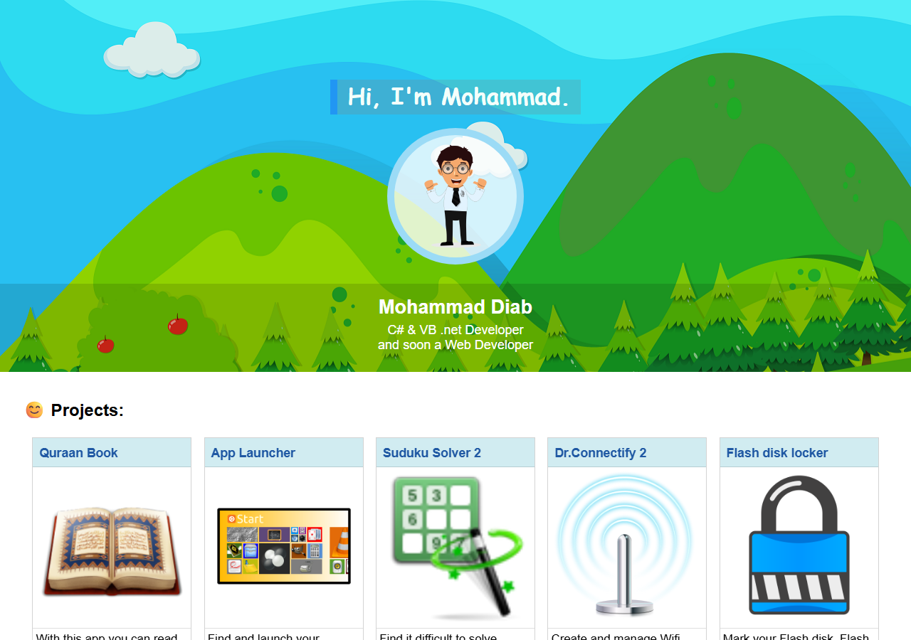

# My-First-Portfolio

My first personal portfolio page, built in 2018: a single static page with a short intro, a photo and a grid of cards for the Windows apps I had written at the time (Quraan Book, App Launcher, Suduku Solver 2, Dr.Connectify 2, Flash disk locker, Duplicate files cleaner and others), split into current and suspended projects. Plain HTML and CSS, no JavaScript, no libraries.

**View it:** https://mohammad-diab.github.io/My-First-Portfolio/



## History

- The first commit is the original 2018 version, which loaded its images from an image host.
- The second commit is the later version: the images are local in `assets/img` and the styles were updated (last edit 2020).

The "Download" buttons are old OneDrive share links from that time and may no longer work.

## Run it locally

```
git clone https://github.com/Mohammad-Diab/My-First-Portfolio.git
```

Then open `index.html` in a browser. Nothing to install or build.

## Author

Mohammad Diab

## License

[MIT](LICENSE)
